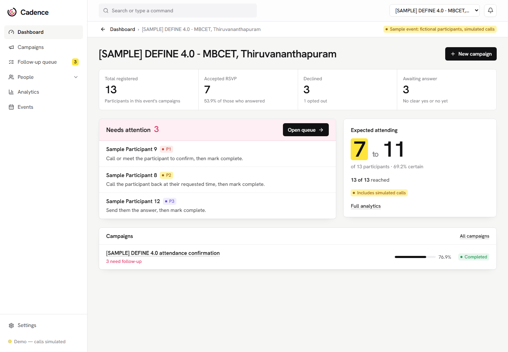
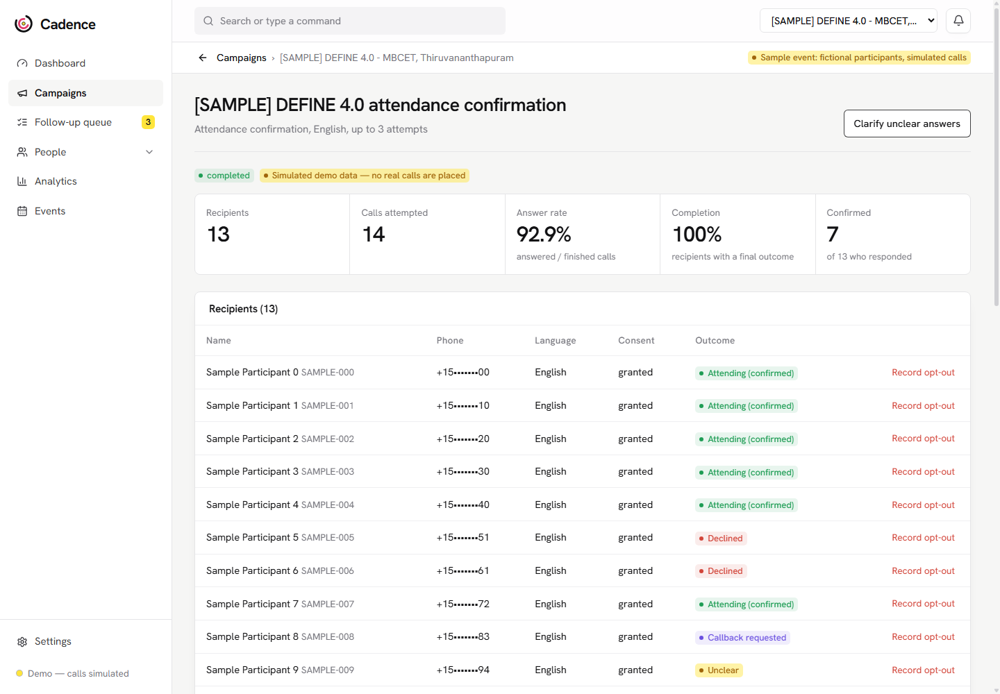
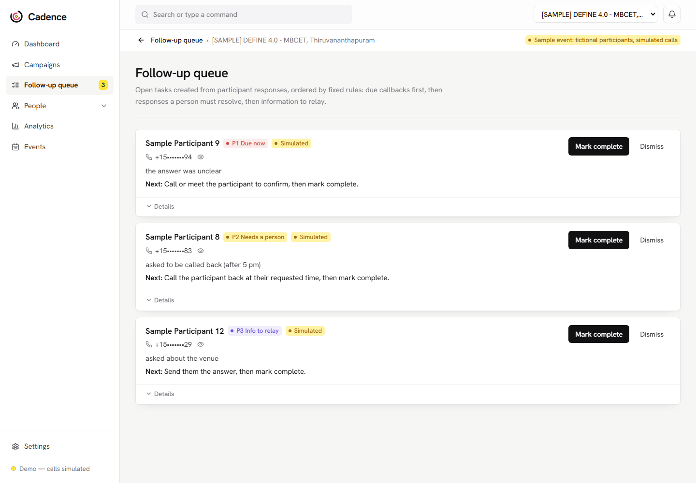
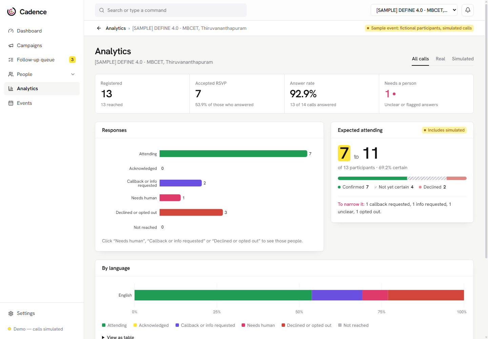
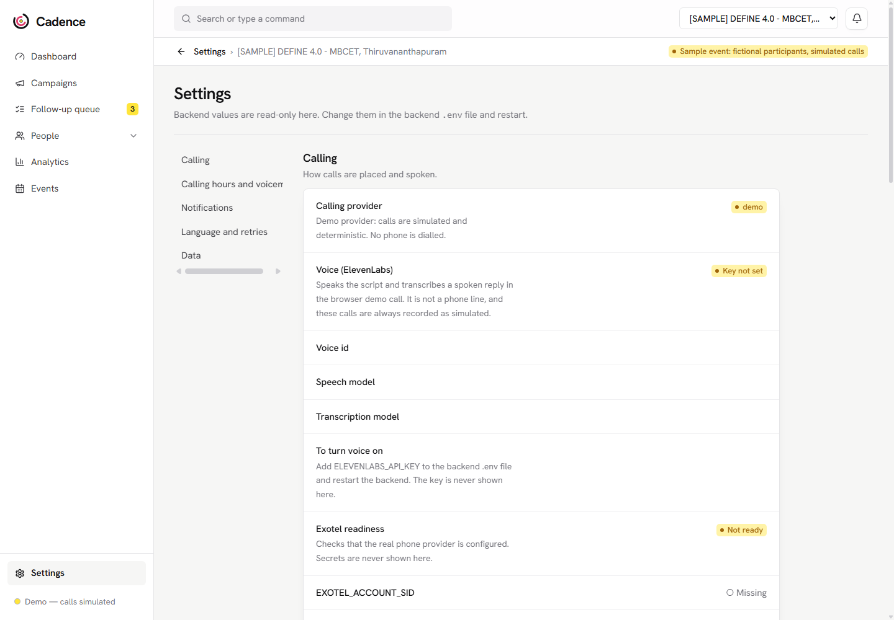
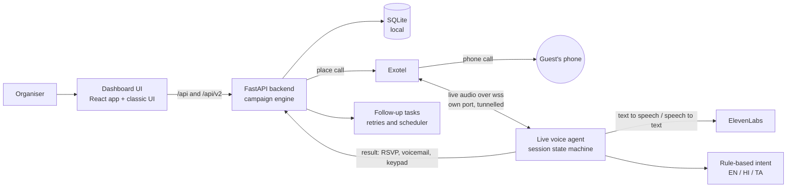

# DEFINE 4.0

The official project submission repository for **DEFINE 4.0 — The World's Realest Hackathon**.

---

# CADENCE

<!-- Add your project cover image below -->



## Team Information

- **Team Name**:
- **Track**:

## Team Members

| Name | Role | GitHub | LinkedIn |
|------|------|--------|----------|
| CHRIS ALEX | Role | [@Chris42alex](https://github.com/Chris42alex) | [Profile](https://linkedin.com/in/chris-oommen-alex) |
| Kevin James | Role | [@Kevinjames005](https://github.com/Kevinjames005) | [Profile](https://linkedin.com/in/kevinjames2005) |
| Athira S | Role | [@athxra](https://github.com/athxra) | [Profile](https://linkedin.com/in/username) |
| Avin Joy | Role | [@ajsike2310](https://github.com/ajsike2310) | [Profile](https://linkedin.com/in/avin-joy-230237260) |

---

# Project Details

## Overview

Cadence turns an event's details and a message template into a live, multilingual outbound calling campaign in a few clicks. An AI voice agent phones each guest in English, Hindi or Tamil, records whether they will attend from their speech or their keypad, handles voicemail and non-responders, and shows the results in a dashboard by campaign, language and audience segment.

## Problem Statement

**What is the problem?** Institutions run seminars, workshops and hackathons across cities and must reach hundreds of people by phone for invitations, RSVPs, reminders and last-minute updates. Today that means volunteers dialling numbers one by one, or sending SMS and email that many people never read. The same need appears in clinic appointment reminders, school-to-parent communication and payment reminders.

**Who is affected?** Event and department organisers who lose hours to calling, and the people being called, who speak different languages, may not pick up, may be on a basic phone with no app, and should not be phoned at night or after asking to stop.

**Why it matters.** Attendance counts decide food, seating and speakers. Unanswered or unclear RSVPs turn into no-shows and wasted cost, and careless calling harms trust and privacy, because contact lists are personal data.

**Limits of existing solutions.**
- Pre-recorded broadcast calls cannot personalise, cannot understand an answer, and force everyone to listen to one language.
- Generic voice-bot builders need technical setup per campaign and rarely handle consent, opt-out, calling hours, voicemail and human follow-up together.
- Dashboards usually stop at "call placed", with no view of who is actually coming, who must be called back by a person, and which language groups respond.

## Solution

Cadence is a platform that converts **a template plus event details into a calling campaign**, runs the calls, understands the answers, and closes the loop with a dashboard.

**Workflow**

1. **Create an event** (webinar, hackathon, seminar, workshop, clinic appointment, school meeting, payment reminder) with date, venue and *approved facts* the agent may state.
2. **Add people** one by one or by CSV, with language, segment and an "OK to call" consent flag.
3. **Create a campaign.** A suggested script is filled in for the event type and language. Every person hears their own name and details, and can have a personal message for that campaign only.
4. **Press start.** The agent calls each person through Exotel. It greets them, asks the question, and listens for speech **or** the keypad (1 yes, 2 no, 3 call back, 4 more information, 9 stop calls).
5. **The system classifies the answer, saves the RSVP, and acts**: unanswered calls are retried automatically on an interval up to a maximum, voicemail is detected and handled, and anything a machine cannot settle becomes a **follow-up task for a person**.
6. **The dashboard** shows outcomes by campaign, language and segment, the expected headcount, and lets staff retry non-responders and resolve follow-ups.

**Why a combination of voice agent, keypad and fixed rules (our design choice).**
- *Pre-recorded only* is cheap but cannot personalise or understand replies. *A fully generative voice agent* is flexible but can improvise wrong facts to real guests.
- Cadence uses a **conversational voice agent with deterministic behaviour**: generated speech for the personalised script, **rule-based intent recognition** (no free-form generation), and **keypad as a first-class fallback**. The agent only ever states facts the organiser entered and says fixed, reviewed lines otherwise. An unknown question goes to a person instead of being guessed. This is predictable, testable and safe for contact with the public.

---

# Demo

### Demo Video

[Watch Project Demo](https://www.youtube.com/watch?v=VIDEO_ID)

> Replace `VIDEO_ID` with your YouTube video ID.

### Screenshots

*Dashboard, with sample (simulated) data:*


*Campaign detail: recipients, attempts and classified responses:*



*Follow-up queue, the people a machine could not settle:*



*Analytics by outcome and language:*



*Settings: calling hours, voicemail, languages and Exotel readiness:*



---

# Live Project

[Visit Live Project](https://your-project-url.com/)

> The system runs on the organiser's own machine or server and uses a tunnel for Exotel's live-audio connection (see Setup). Replace the link above if you deploy it.

---

# Technical Implementation

## Technologies Used

| Category | Technologies |
|----------|--------------|
| **Frontend** | React 18, TypeScript, Vite, Tailwind CSS 4, Recharts, React Router (`frontend/`); plus a lightweight no-build HTML/JS dashboard (`dashboard/static/`) |
| **Backend** | Python 3.13, FastAPI, Uvicorn, WebSockets, Pydantic, httpx |
| **Database** | SQLite (local file; events, contact lists, per-call outcomes; no audio or transcripts) |
| **APIs / Services** | Exotel Voice (outbound calls and bidirectional audio streaming), ElevenLabs (text-to-speech: Multilingual v2; speech-to-text: Scribe v2) |
| **AI / ML** | Conversational voice agent; speech recognition and speech synthesis through ElevenLabs; **deterministic rule-based intent classification** in English, Hindi and Tamil (script detection, phrase matching, keypad map), with measured test cases |
| **DevOps / Deployment** | ngrok or Cloudflare tunnel for the audio WebSocket, `.env` configuration, pytest and Vitest test suites |
| **Other Tools** | NumPy (audio segmentation), python-dotenv, Git |

## System Architecture

<!-- Add your architecture diagram here -->


> Add `assets/architecture.png` if you have a diagram. The same architecture in text form:



**Where voice and language processing happens**

| Step | Where | Notes |
|------|-------|-------|
| Telephony (placing the call, carrying audio) | Exotel | The telecom provider |
| Speech to text and text to speech | ElevenLabs cloud, streamed during the call | Audio is processed live; **Cadence never stores audio or transcripts** |
| Language detection, intent classification, keypad handling, voicemail detection, next action | **On our own server** (Python), deterministic code | No audio or text is sent to any language model for decisions |
| Contact lists, consent, RSVPs, outcomes | **Local SQLite file on our server** | Not sent to third parties except the number being dialled |

## Key Features

- **Template to campaign in minutes**: suggested scripts per event type (webinar, hackathon, seminar, workshop, conference, clinic, school, payment) and purpose (invite, reminder, update, thank-you), with live preview per person.
- **Personalised calls**: every guest hears their own name and event details; per-person personal messages that apply to one campaign only; Hindi and Tamil scripts follow each person's preferred language.
- **Speech *and* keypad**: say yes or no, or press 1 to confirm, 2 to decline, 3 for a call back, 4 for information, 9 to stop. The keys are offered on every question call and again when the person is silent or unclear.
- **Voicemail handled properly**: the agent listens before speaking, recognises an answering machine, hangs up without saying anything personal, records it as *voicemail* (not an answer), retries later, and can optionally leave a short neutral note.
- **Automatic retries**: non-responders (no answer, busy, voicemail, silent) are called again after a chosen interval up to a maximum, then handed to a person.
- **Conversation, not just a menu**: the caller can switch language mid-call ("speak Hindi") and ask what the organiser has approved (venue, time, organiser, what the event is about). Unknown questions go to a person.
- **Follow-up queue for humans**: unclear answers, call-back requests, questions the agent could not answer, and people who could not be reached after the last attempt become tasks. Resolving one can record the RSVP.
- **Outcomes dashboard**: by campaign, language and audience segment; expected-attendance range with certainty; one-click **retry non-responders**; CSV export; scheduled campaign start.
- **Privacy and compliance controls**: per-person consent ("OK to call"), opt-out honoured immediately and permanently, erase a person and their records, configurable calling hours, optional access token, no audio or transcript storage, and an allowed-numbers safety list for testing.
- **Other use cases with the same engine**: clinic appointment reminders, school-parent meetings and payment reminders (custom fields such as `{amount}` from a CSV column), plus a lead-capture page and sample (always simulated) data.

---

# Setup Instructions

## Prerequisites

Make sure the following are installed before running the project:

- Python 3.10 or newer (developed and tested on 3.13) and `pip`
- Node.js 20 or newer and `npm` (only to build the React frontend)
- For **real calls**: an Exotel account with the Voice AI streaming feature enabled, an ElevenLabs API key, and a tunnel such as ngrok or cloudflared so Exotel can reach your machine's audio port
- Without those, the project runs fully in **demo mode** with simulated calls

## Installation

### 1. Clone the Repository

```bash
git clone <repository-url>
cd <repository-folder>
```

### 2. Install the backend

```bash
python -m venv venv
# Windows:   venv\Scripts\activate        macOS / Linux:   source venv/bin/activate
pip install -r requirements.txt
```

### 3. Configure

```bash
cp .env.example .env        # Windows: copy .env.example .env
```

Leave `CALL_PROVIDER=demo` to try everything without placing a call. For real calls set `CALL_PROVIDER=exotel` and fill the `EXOTEL_*` and `ELEVENLABS_*` values. Set `DASHBOARD_TOKEN` before exposing anything beyond your own machine. **Never commit `.env`.**

### 4. Build the React frontend (optional, recommended)

```bash
cd frontend
npm install
npm run build
cd ..
```

### 5. Run

```bash
python -m scripts.run_dashboard
```

| What | Address |
|------|---------|
| React app | http://127.0.0.1:8002/app/ |
| Classic dashboard | http://127.0.0.1:8002/ |
| Live-audio WebSocket (what Exotel connects to) | port **8003** |

For real calls, tunnel **only port 8003**, so the dashboard and contact lists never face the internet:

```bash
ngrok http 8003
```

Then set `EXOTEL_STREAM_URL=wss://<your-tunnel-host>/live/exotel/<EXOTEL_WEBHOOK_TOKEN>` in `.env` and restart.

### 6. Try it

1. Open the React app. On the empty dashboard choose **Load sample events and run simulation**.
2. Open a campaign to see attempts, classified responses and follow-ups, then **Follow-up queue** and **Analytics**.
3. Create your own event, add people (CSV with `name, phone`), create a campaign, and press **Start**.

### 7. Run the tests

```bash
python -m pytest                 # backend, call agent and API (246 tests)
cd frontend && npm test          # frontend (32 tests)
```

## Project structure

```
dashboard/   Campaign engine, SQLite storage, REST APIs (/api and /api/v2), classic dashboard UI
frontend/    React + TypeScript dashboard (served at /app/)
member3/     Telephony and intelligence: Exotel adapter, live voice agent, intent rules, EN/HI/TA
scripts/     run_dashboard, simulate_call, check_exotel, place_test_call, ...
assets/      README images
```

## Honest limits

- Hindi and Tamil wording has not been reviewed by native speakers (`member3/NATIVE_REVIEW.md`). Malayalam rules exist, but the call agent cannot speak Malayalam yet.
- Intent recognition is rule-based phrase matching with a small evaluation set, not a trained model. Unclear answers are never counted as a yes; they go to a person.
- Answering-machine detection is a timing-and-phrase heuristic, not Exotel's own machine detection. Doubtful cases are treated as a person.
- Real-call behaviour was verified on a live Exotel test account; larger-scale operation has not been load tested. Run a single server process.
- ElevenLabs (a third party) performs speech recognition and synthesis during the call; this is disclosed in the data-location table above.
